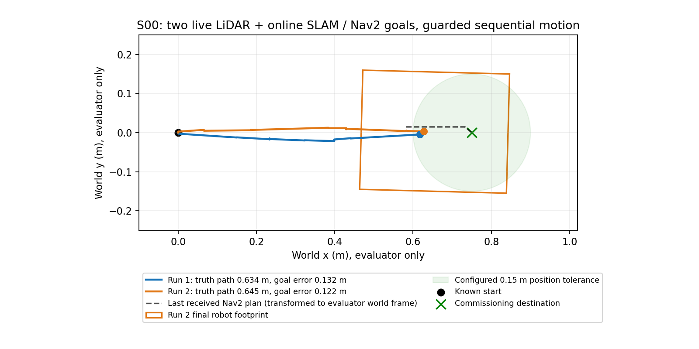

# First realistic sensor-derived S00 goals — 2026-11-03

## Result

**Two fresh headless S00 commissioning trials PASS end to end.** Live LiDAR -> online SLAM /map and localization -> Nav2 planner/controller -> velocity smoother -> collision monitor -> authoritative safety guard -> robot motion. No reference occupancy map or simulator truth was supplied to runtime navigation. Ground truth was consumed only by the evaluator.

The destination was 0.75 m ahead of the known S00 start, intentionally a bounded first commissioning goal. This is not the longer Phase 6 reference course and not a demonstration of general obstacle avoidance, parking or exploration. S01 was not attempted.

| Measurement | Accepted run 1 | Accepted confirmation run |
|---|---:|---:|
| Nav2 action | SUCCEEDED | SUCCEEDED |
| Overall evaluation | PASS | PASS |
| Truth path length m | .6340 | .6452 |
| Final goal position error m | .1323 | .1223 |
| Final goal heading error rad | .0580 | .0264 |
| Final localization position error m | .00493 | .01104 |
| Final localization heading error rad | .00098 | .00112 |
| Minimum conservative static clearance m | 2.5643 | 2.5735 |
| Non-ground collisions | 0 | 0 |
| Final pose-rate stop confirmed | yes | yes |
| Fresh RGB / scan / map / filtered odometry | yes | yes |
| Sole final command publisher | anc_safety_command_guard | anc_safety_command_guard |
| Runtime real-time factor | .986 | .987 |
| Sampled matching-process peak RSS MiB | 1719.25 | 1716.23 |

All six required lifecycle nodes were active. Run 1 observed 189 RGB frames, 189 scans, 38 SLAM map updates, 23 global costmap updates and 27 plans. The second run independently repeated the same procedure. Source poses and commanded trajectories are saved. CPU/RSS samples are best effort, include shared-page double counting, and are not whole-system peaks; legacy resource field names mentioning WSL refer to this native Linux run.



## Corrections that led to the result

- Local costmap width/height changed from YAML floating-point values to integer values required by installed Nav2.
- Behavior plugin names changed to the installed `nav2_behaviors::...` registry names.
- Velocity smoother input now uses an actual ROS remap from cmd_vel to /cmd_vel_nav_raw. The previous YAML pseudo-topic parameters were ignored by this version; the disconnected smoother produced zeros.
- RPP minimum lookahead .35 m now exceeds tightened .15 m goal position tolerance. Previously .20 m lookahead was below .30 m goal tolerance, so its carrot-distance goal-heading test could trigger premature final rotation. Goal heading tolerance is tightened to .08 rad. Source inspected: https://github.com/ros-navigation/navigation2/blob/jazzy/nav2_regulated_pure_pursuit_controller/src/regulated_pure_pursuit_controller.cpp.
- Align-before-drive threshold .01 rad and angular deadband .015 rad/s suppress tiny steering corrections, allowing validated pure forward/turn commands. Larger mixed requests remain rejected by the guard. No curved-motion authority was enabled.
- A runtime odometry interlock requires .50 s observed slow rates plus >=1.25 s since the last nonzero primitive before changing forward/yaw primitive or yaw direction. It uses filtered odometry, not truth, and fails closed on stale/nonfinite odometry. These restrictions apply to normal production-sequential mode; they do not broaden the tested yaw envelope.
- A six-second Nav2 startup delay separates Gazebo's initialization burst. An intermediate lifecycle service response was lost; that failed launch is preserved. Fresh ROS domains are selectable for independent commissioning runs.
- Publisher auditing now uses the evaluator's in-process ROS graph. Four sequential CLI calls previously blocked its sensor callbacks and falsely aged the final observations. The earlier run with a successful action but failed freshness evaluation remains FAIL; the accepted runs are new simulations.

The confirmation command CSV recorded **zero mixed guarded output samples**. Observed receive-time zero-command gaps between primitives/directions were approximately 1.2496–1.4499 s, consistent with the runtime's 1.25 s minimum and submillisecond delivery jitter. This is deliberately stop/align/drive behavior, not smooth arc following. Extra stops and heading corrections make this short goal take about 33 s.

## Safety and prerequisites

Turning evidence: native-turn-production-matrix-20261103/envelope.json, independently validating all 13 live production-controller cases. Moving-SLAM evidence: three distinct passing native-slam-map1s-20261103 trials. Before sending the goal, commissioning audits exactly one guard publisher; all normal sensor, clearance, collision-monitor and watchdog checks stay active. The evaluator adds a 1.5 m travel abort, memory abort, collision abort, localization-error checks and post-goal .5 s stationary confirmation. The normal demonstration readiness flags were not manually enabled.

Defaults remain conservative. Production-sequential authority is opt-in with verified hashed evidence, capped at .10 rad/s angular and the existing forward speed gate; the smoother limits commissioning forward speed to .12 m/s. Reverse and mixed outputs are rejected. No hardware validation or safety certification is implied by these simulator results. Production stopping measurements and the justified V2 contract are in native-production-turning-20261103.md and phase8c-turn-stop-contract.md.

## Preserved attempts

- Initial and first retry: no goal sent; incompatible costmap types, then legacy behavior names prevented activation.
- Retry2: goal accepted, zero movement, disconnected smoother; TIMEOUT.
- Retry3: guarded pure rotations but no forward progress; premature goal-heading behavior; TIMEOUT.
- Retry4: raw forward + yaw requests correctly rejected as unvalidated mixed motion; TIMEOUT.
- Retry5: action SUCCEEDED and stop observed, but overall FAIL due blocking-audit freshness artifact.
- Retry6: lost lifecycle service response; no goal sent.
- Retry7 and separate confirmation: fresh overall PASS results.

Do not count the failed attempts as successes. Their results, bounded logs and trajectories are versioned under docs/evidence/native-nav2-s00-commission*. Large raw terminal originals remain local. Successful evidence: native-nav2-s00-commission-retry7-20261103 and native-nav2-s00-confirmation-20261103. The latter includes guarded-commands.csv and the measured path plot.

## Reproduce

From repository root, with no other project simulator running:

```bash
source /opt/ros/jazzy/setup.bash
source simulation/ros2_ws/install/setup.bash
OPENBLAS_NUM_THREADS=1 OMP_NUM_THREADS=1 python3 scripts/commission_lidar_s00.py \
  docs/evidence/native-turn-production-matrix-20261103/envelope.json \
  "docs/evidence/s00-new-$(date +%Y%m%dT%H%M%S)" --timeout-s 60 --domain-id 42
```

To request Gazebo + RViz for the same bounded autonomous goal:

```bash
OPENBLAS_NUM_THREADS=1 OMP_NUM_THREADS=1 python3 scripts/commission_lidar_s00.py \
  docs/evidence/native-turn-production-matrix-20261103/envelope.json \
  "docs/evidence/s00-visual-$(date +%Y%m%dT%H%M%S)" \
  --timeout-s 60 --domain-id 42 --gui --rviz
```

GUI startup requires >=2560 MiB available, versus 2048 MiB headless. Both retain runtime memory and safety aborts. GUI command support is prepared; this session's accepted evidence is headless, not a desktop recording. The generic run_lidar_demo.sh still uses its older blocked readiness workflow; use the explicit evidence-validated commissioning command above for the new bounded S00 capability.

For the preserved reference-map demonstration:

```bash
python3 scripts/phase6_navigation_runner.py --scenario S00 --seed 101 \
  --run-id "phase6-visual-$(date +%Y%m%dT%H%M%S)" --gui --rviz --hold-window
```

Run only one simulation at a time. Phase 6 source/configuration was not changed by this work. S01 avoidance, long-route drift, exploration, parking and hardware remain pending.

Final checks: sequential full workspace rebuild passed all nine packages in 9.41 s; rosdep reports all system dependencies satisfied; 86 Phase 8C offline tests passed. No project simulator remained running after verification. Git milestones are pushed directly to feature/phase8c-lidar with remote SHA verification; no PR, main merge or history rewrite was used.

Native Ubuntu follow-up: project commissioning now accepts domain IDs 0..100 to avoid the host ephemeral-port range. Historical high-domain run data is preserved; current reproduction commands use the lower range. See native-gui-s01-distance-20261104.md.
